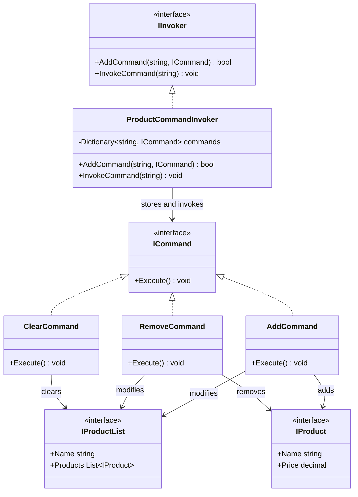

# Command

## Description

The Command pattern is a behavioral design pattern that encapsulates a request as an object. The invoker can execute the request without knowing how it is carried out or which receiver it affects. Concrete commands bind an operation to the receiver and its required data.

In this implementation, `ProductCommandInvoker` registers commands under string keys and invokes them later. `AddCommand`, `RemoveCommand`, and `ClearCommand` encapsulate operations on an `IProductList`.

## Diagram



## Roles

| Class / Interface | Pattern Role | Responsibility |
| --- | --- | --- |
| `ICommand` | Command | Defines the common `Execute` operation. |
| `AddCommand` | Concrete Command | Adds its product to the supplied product list. |
| `RemoveCommand` | Concrete Command | Removes its product from the supplied product list. |
| `ClearCommand` | Concrete Command | Clears the supplied product list. |
| `IProductList` | Receiver | Owns the product collection that commands modify. |
| `ProductCommandInvoker` | Invoker | Registers commands by key and invokes the selected command. |
| Calling code | Client | Creates commands with their receiver and data, registers them, and chooses when to invoke them. |

## Request Flow

The client constructs a command with the receiver and the data needed for its operation, registers it with an `IInvoker`, and later asks the invoker to execute it by key. The invoker calls `Execute()` without needing to know the command's implementation.

```csharp
IInvoker invoker = new ProductCommandInvoker();

// productList and product are provided by the application.
ICommand addProduct = new AddCommand(productList, product);
invoker.AddCommand("add-product", addProduct);
invoker.InvokeCommand("add-product");
```

`ProductCommandInvoker.AddCommand` returns `false` if a key is already registered. `InvokeCommand` indexes the dictionary directly, so invoking an unknown key currently throws `KeyNotFoundException`.

## Benefits

- Separates the caller that requests an operation from the object that performs it.
- Encapsulates each operation and its required data in a command object.
- Allows operations to be selected and invoked by key at runtime.
- Makes it straightforward to add commands that implement `ICommand` without changing the invoker.

## When to Use

Use the Command pattern when you want to parameterize callers with operations, defer execution, or keep request selection separate from request implementation. It is also a useful foundation for features such as command queues, logging, retries, and undo, although those features require additional state and behavior beyond the current implementation.
