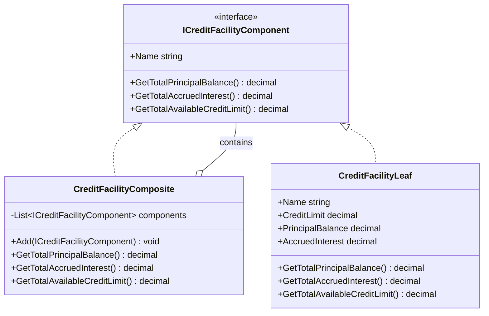

# Composite

## Description

The Composite is a structural design pattern that lets clients treat individual objects and groups of objects through the same interface. A composite contains child components and implements operations by delegating to those children, allowing nested tree structures to be processed uniformly.

In this example, a syndicated credit facility contains tranches, and a tranche may contain loan accounts. A `CreditFacilityLeaf` represents a terminal account or tranche with its own balance; a `CreditFacilityComposite` represents a facility or tranche that contains other components. Drawing funds is an operation on an account, not the account itself. Both types implement `ICreditFacilityComponent`, so the client can request aggregate balances from the master facility without knowing the tree's depth.

## Diagram



## Roles

| Class / Interface | Composite Role | Responsibility |
| --- | --- | --- |
| `ICreditFacilityComponent` | Component | Defines the common name and balance operations available on leaves and composites. |
| `CreditFacilityLeaf` | Leaf | Represents a terminal loan account or tranche; reports its principal, accrued interest, and unused committed credit. |
| `CreditFacilityComposite` | Composite | Contains child components and sums their reported balances and available credit. It can represent the master facility or a nested tranche. |
| Calling code | Client | Builds the facility hierarchy and queries the master component through the shared interface. |

## Example: Syndicated Loans and Multi-Tranche Facilities

A master credit facility can contain multiple tranches:

- **Tranche A - Term Loan:** A composite containing individual loan accounts.
- **Tranche B - Revolver:** A leaf when represented as one terminal account, or a composite when represented by multiple accounts.
- **Tranche C - Mezzanine:** A leaf or composite depending on how its allocations are modeled.

The client calls `GetTotalPrincipalBalance()`, `GetTotalAccruedInterest()`, or `GetTotalAvailableCreditLimit()` on the master facility. Each composite delegates the operation to its children and sums their results, regardless of how deeply the tranches are nested.

```csharp
var termLoanTranche = new CreditFacilityComposite("Tranche A - Term Loan");
termLoanTranche.Add(new CreditFacilityLeaf("Term Loan account 1", 400m, 300m, 12m));
termLoanTranche.Add(new CreditFacilityLeaf("Term Loan account 2", 100m, 50m, 3m));

var masterFacility = new CreditFacilityComposite("Syndicated Credit Facility");
masterFacility.Add(termLoanTranche);
masterFacility.Add(new CreditFacilityLeaf("Tranche B - Revolver", 300m, 120m, 4m));
masterFacility.Add(new CreditFacilityLeaf("Tranche C - Mezzanine", 200m, 200m, 10m));

decimal principal = masterFacility.GetTotalPrincipalBalance();       // 670m
decimal interest = masterFacility.GetTotalAccruedInterest();         // 29m
decimal available = masterFacility.GetTotalAvailableCreditLimit();   // 330m
```

A leaf computes available credit as its committed limit minus its principal balance. Composite nodes sum their children's available credit; commitment amounts should therefore be assigned at the leaves to avoid counting the same limit at multiple levels.

## Benefits

- Clients use one component interface for both individual loan accounts and entire facilities.
- Aggregate calculations work recursively without the caller traversing the hierarchy.
- Tranches can be reorganized or nested without changing balance-querying code.
- New leaf or composite types can be added while preserving the shared operations.

## When to Use

Use the Composite pattern when domain objects naturally form part-whole hierarchies and clients need to perform the same operations on a single item and a group. Examples include organizational trees, file systems, portfolios, and nested credit facilities.
