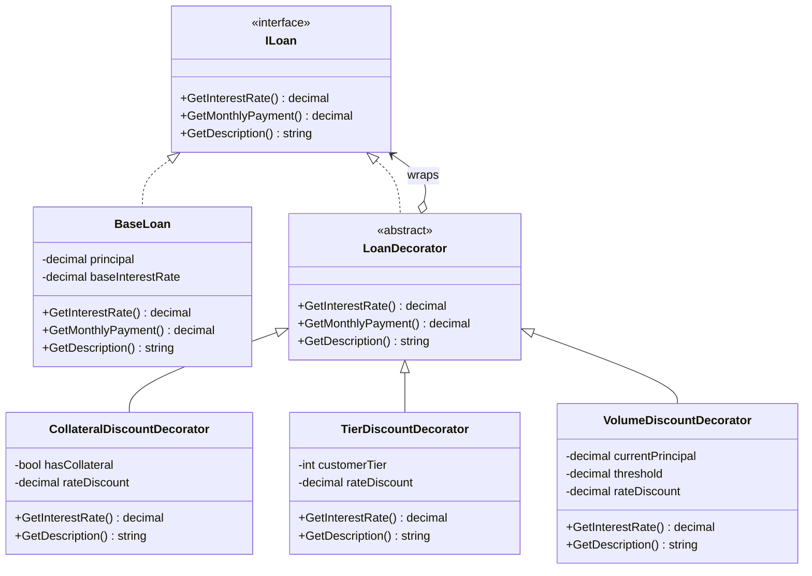

# Decorator

## Description

The Decorator is a structural design pattern that adds behavior to an object by wrapping it in another object that implements the same interface. Decorators can be stacked, allowing a client to combine optional behaviors without creating a separate subclass for every combination.

In this implementation, `BaseLoan` provides the starting interest rate, monthly payment, and description. `CollateralDiscountDecorator`, `TierDiscountDecorator`, and `VolumeDiscountDecorator` wrap an `ILoan`, conditionally reduce its interest rate, and append the applied discount to its description. Each wrapped loan remains usable through the same `ILoan` interface.

## Diagram



## Roles

| Class / Interface | Decorator Role | Responsibility |
| --- | --- | --- |
| `ILoan` | Component | Defines the interest-rate, monthly-payment, and description operations. |
| `BaseLoan` | Concrete Component | Supplies the starting loan terms. |
| `LoanDecorator` | Base Decorator | Wraps an `ILoan` and delegates operations by default. |
| `CollateralDiscountDecorator` | Concrete Decorator | Applies a rate discount when the loan has collateral. |
| `TierDiscountDecorator` | Concrete Decorator | Applies a rate discount for customer tiers of 1 or higher. |
| `VolumeDiscountDecorator` | Concrete Decorator | Applies a rate discount when principal meets or exceeds the configured threshold. |
| Calling code | Client | Composes the desired decorators around a loan. |

## Example: Composing Loan Discounts

A client can wrap a standard loan with only the discounts it qualifies for:

```csharp
ILoan loan = new BaseLoan(300_000m, 0.08m);
loan = new CollateralDiscountDecorator(loan, hasCollateral: true, rateDiscount: 0.01m);
loan = new TierDiscountDecorator(loan, customerTier: 1, rateDiscount: 0.005m);
loan = new VolumeDiscountDecorator(loan, currentPrincipal: 300_000m, threshold: 250_000m, rateDiscount: 0.0025m);

decimal interestRate = loan.GetInterestRate(); // 0.0625m
string description = loan.GetDescription();    // Includes all three discounts
```

Each decorator uses the wrapped loan's current rate, so eligible discounts accumulate as the wrappers are applied. Their descriptions are appended in the same order as the wrapping.

## Implementation Note

`LoanDecorator.GetMonthlyPayment()` delegates directly to its wrapped loan, and none of the concrete discount decorators override it. As currently implemented, a rate discount changes the reported interest rate and description but does not recalculate the monthly payment.

## Benefits

- Adds optional loan behavior without changing `BaseLoan` or the `ILoan` contract.
- Allows discounts to be combined at runtime by stacking decorators.
- Keeps each discount rule isolated in its own class.
- Avoids subclasses for every possible combination of collateral, customer tier, and loan size.

## When to Use

Use the Decorator pattern when objects need optional, composable behavior and the wrapped objects should remain interchangeable through a stable interface. It is useful when combinations of features would otherwise lead to a growing set of specialized subclasses.
