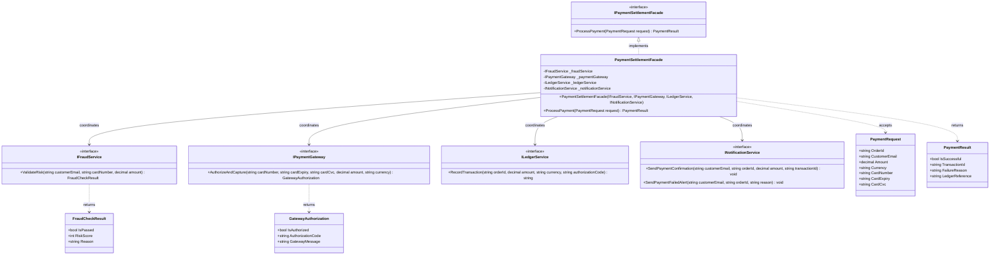

# Facade Pattern

## Description

The Facade pattern is a structural design pattern that provides a simplified, unified high-level interface to a complex subsystem of components, services, or APIs. It hides the underlying complexity, sequencing, and error-handling requirements of multiple disparate subsystems, offering a clean, cohesive entry point for client applications.

In this implementation, the **PaymentSettlementFacade** coordinates an end-to-end payment settlement workflow across four distinct subsystems:

1. **IFraudService**: Performs fraud analysis and velocity risk scoring before any funds are moved.
2. **IPaymentGateway**: Communicates with card acquirer networks to authorize and capture transaction amounts.
3. **ILedgerService**: Records double-entry accounting entries into the general ledger upon successful payment.
4. **INotificationService**: Dispatches real-time confirmation receipts or failure alerts to the customer.

Without the facade, calling code (such as an order checkout controller) would need to inject, sequence, and handle errors across all four services. With the `PaymentSettlementFacade`, callers invoke a single, self-contained method: `ProcessPayment(request)`.

---

## Real-World Analogy: Retail Checkout Settlement

Think of paying at an online checkout or retail point-of-sale:

- **The Facade (`PaymentSettlementFacade`):** The single "Complete Purchase" button or checkout service. The client only provides order and card information, receiving a clean `PaymentResult`.
- **The Complex Subsystems Coordinated Behind the Scenes:**
  - **Risk & Fraud Evaluation:** Verifying device fingerprint, geolocation, and cardholder transaction velocity. If risk exceeds the acceptable threshold, the process halts immediately to prevent fraudulent charges.
  - **Card Network Authorization:** Formatting ISO network requests, verifying CVV and card expiry, and holding funds through acquiring banks.
  - **General Ledger Accounting:** Creating balanced debit and credit entries (debiting Cash Settlement, crediting Accounts Receivable / Sales Revenue).
  - **Customer Notifications:** Generating PDF receipts, sending email confirmations, or alerting the customer of payment failure reasons.

```
                  [ Checkout Client Application ]
                                │
                                ▼  ProcessPayment(request)
                  [ PaymentSettlementFacade ]
                                │
       ┌────────────────┬───────┴────────┬────────────────┐
       ▼                ▼                ▼                ▼
[ IFraudService ] [ IPaymentGateway ] [ ILedgerService ] [ INotificationService ]
(Risk Scoring)    (Card Acquirer)     (Double-entry GL)  (Email / SMS Alerts)
```

The caller never coordinates network calls, error-abort logic, or ledger entries directly; the facade encapsulates the entire multi-service lifecycle.

---

## UML Diagram



---

## Role Mapping

| Class / Interface | Facade Pattern Role | Description |
|---|---|---|
| `IPaymentSettlementFacade` | **Facade Interface** | Defines the high-level, simplified entry point for payment settlement. |
| `PaymentSettlementFacade` | **Concrete Facade** | Implements the pipeline: runs fraud check, requests gateway authorization, records ledger entry, and sends notifications. |
| `IFraudService` | **Subsystem Service** | Analyzes customer and card transaction parameters to determine risk thresholds. |
| `IPaymentGateway` | **Subsystem Service** | Communicates with external payment card networks to authorize and capture funds. |
| `ILedgerService` | **Subsystem Service** | Records balanced accounting entries in the double-entry general ledger. |
| `INotificationService` | **Subsystem Service** | Sends transactional confirmation receipts and failure alerts to customers. |
| `PaymentRequest` / `PaymentResult` | **Data Contracts** | Input parameters and unified result DTOs used to communicate through the facade. |
| `FacadeShould` / Client | **Client** | Consumes `IPaymentSettlementFacade` without coupling to internal subsystem contracts. |

---

## Key Advantages

1. **Shields Callers from Subsystem Coupling**
   Clients depend only on `IPaymentSettlementFacade` rather than injecting and wiring 4+ separate services. If an internal subsystem changes (e.g. switching ledger providers or upgrading the fraud model), client code remains untouched.

2. **Guarantees Execution Sequencing and Business Invariants**
   The facade ensures that critical steps occur in strict order:
   - Fraud screening runs *before* card capture (avoiding unnecessary processing fees and chargebacks).
   - If fraud checks or gateway authorizations fail, execution short-circuits: the general ledger is never touched, and a failure alert is sent instead.
   - Accounting ledger records are created only *after* successful authorization.

3. **Loose Coupling Across Layer Boundaries**
   In layered or modular monolith architectures, a facade provides a clear boundary for a domain module, preventing deep cross-module dependencies.

4. **Significantly Cleaner Testing**
   Callers of payment functionality only need to mock `IPaymentSettlementFacade`, rather than assembling mock graphs for fraud, gateways, ledgers, and notifications in every consumer test.

---

## Scenarios: When to Use the Facade Pattern

### 1. Payment Settlement & Multi-Service Checkout Pipelines
Processing orders requires orchestrating multiple independent APIs (risk scoring, card authorization, inventory reservation, ledger entry, confirmation emails). A facade coordinates this sequence and manages short-circuit failures.

### 2. Loan Origination & Disbursement
Disbursing approved loan funds requires verifying identity against sanction/AML lists, generating payment rail transfers (ACH / wire), posting disbursement ledger lines, and archiving signed disclosure documents. A `LoanDisbursementFacade` encapsulates this entire flow.

### 3. Third-Party Vendor API Wrapping
Complex enterprise vendor SDKs (e.g., Salesforce, SAP, AWS) expose hundreds of classes and fine-grained methods. A facade provides the 20% of high-level methods your application actually uses, shielding your domain from external SDK revisions.

### 4. Microservice Aggregation (API Gateway / Backend-For-Frontend)
When a mobile or web client needs data spanning multiple backend microservices (e.g. Account Summary = Customer Profile + Account Balances + Recent Transactions), a gateway facade aggregates these calls into a single response.

---

## Facade vs. Other Structural Patterns

| Pattern | Primary Intent | Key Difference from Facade |
|---|---|---|
| **Facade** | Defines a **new, simplified interface** to a complex subsystem of multiple services | Cohesive entry point over multiple classes; unidirectional communication |
| **Adapter** | Converts an **existing incompatible interface** to match what a client expects | 1:1 interface translation; makes incompatible legacy interfaces work together |
| **Proxy** | Provides a surrogate with the **exact same interface** to control access or add caching | Same interface as the target; intercepts calls to a single object |
| **Mediator** | Centralizes **bidirectional communication** among colleague objects | Coordinates communication *among* peers; colleagues know about the mediator |

---

## Code Walkthrough

### 1. The Complex Subsystem Without a Facade
Without the facade, every client calling checkout must handle orchestration and short-circuit error paths manually:

```csharp
// Without Facade: Client must inject 4 services and manage sequencing + error flows
public class CheckoutController(
    IFraudService fraudService,
    IPaymentGateway gateway,
    ILedgerService ledger,
    INotificationService notifications)
{
    public IActionResult CompleteCheckout(PaymentRequest request)
    {
        var fraud = fraudService.ValidateRisk(request.CustomerEmail, request.CardNumber, request.Amount);
        if (!fraud.IsPassed)
        {
            notifications.SendPaymentFailedAlert(request.CustomerEmail, request.OrderId, fraud.Reason);
            return BadRequest("Fraud check failed");
        }

        var auth = gateway.AuthorizeAndCapture(request.CardNumber, request.CardExpiry, request.CardCvc, request.Amount, request.Currency);
        if (!auth.IsAuthorized)
        {
            notifications.SendPaymentFailedAlert(request.CustomerEmail, request.OrderId, auth.GatewayMessage);
            return BadRequest("Card declined");
        }

        var ledgerRef = ledger.RecordTransaction(request.OrderId, request.Amount, request.Currency, auth.AuthorizationCode);
        notifications.SendPaymentConfirmation(request.CustomerEmail, request.OrderId, request.Amount, auth.AuthorizationCode);

        return Ok(new { AuthCode = auth.AuthorizationCode, LedgerRef = ledgerRef });
    }
}
```

### 2. With the `PaymentSettlementFacade`
With the facade, the client becomes concise, robust, and completely insulated from subsystem changes:

```csharp
// With Facade: Client interacts through a single, unified method
public class CheckoutController(IPaymentSettlementFacade settlementFacade)
{
    public IActionResult CompleteCheckout(PaymentRequest request)
    {
        var result = settlementFacade.ProcessPayment(request);

        if (!result.IsSuccessful)
        {
            return BadRequest(result.FailureReason);
        }

        return Ok(new { result.TransactionId, result.LedgerReference });
    }
}
```

---

## Unit Testing the Facade

Using **NSubstitute** and **Shouldly**, unit tests verify the coordination, sequencing, and short-circuit logic of the facade in isolation:

```csharp
[Fact]
public void ProcessPayment_ShouldSucceed_WhenAllSubsystemsPass()
{
    // Arrange
    var fraudService = Substitute.For<IFraudService>();
    var gateway = Substitute.For<IPaymentGateway>();
    var ledger = Substitute.For<ILedgerService>();
    var notifications = Substitute.For<INotificationService>();

    fraudService.ValidateRisk(Arg.Any<string>(), Arg.Any<string>(), Arg.Any<decimal>())
        .Returns(new FraudCheckResult(IsPassed: true, RiskScore: 10));

    gateway.AuthorizeAndCapture(Arg.Any<string>(), Arg.Any<string>(), Arg.Any<string>(), Arg.Any<decimal>(), Arg.Any<string>())
        .Returns(new GatewayAuthorization(IsAuthorized: true, AuthorizationCode: "AUTH-100", GatewayMessage: "Approved"));

    ledger.RecordTransaction(Arg.Any<string>(), Arg.Any<decimal>(), Arg.Any<string>(), Arg.Any<string>())
        .Returns("GL-REC-555");

    var facade = new PaymentSettlementFacade(fraudService, gateway, ledger, notifications);

    // Act
    var result = facade.ProcessPayment(sampleRequest);

    // Assert
    result.IsSuccessful.ShouldBeTrue();
    result.TransactionId.ShouldBe("AUTH-100");
    result.LedgerReference.ShouldBe("GL-REC-555");

    // Verify subsystem orchestration
    fraudService.Received(1).ValidateRisk(Arg.Any<string>(), Arg.Any<string>(), Arg.Any<decimal>());
    gateway.Received(1).AuthorizeAndCapture(Arg.Any<string>(), Arg.Any<string>(), Arg.Any<string>(), Arg.Any<decimal>(), Arg.Any<string>());
    ledger.Received(1).RecordTransaction(Arg.Any<string>(), Arg.Any<decimal>(), Arg.Any<string>(), "AUTH-100");
    notifications.Received(1).SendPaymentConfirmation(Arg.Any<string>(), Arg.Any<string>(), Arg.Any<decimal>(), "AUTH-100");
}

[Fact]
public void ProcessPayment_ShouldAbortAndAlert_WhenFraudCheckFails()
{
    // Arrange: Fraud check fails
    var fraudService = Substitute.For<IFraudService>();
    fraudService.ValidateRisk(Arg.Any<string>(), Arg.Any<string>(), Arg.Any<decimal>())
        .Returns(new FraudCheckResult(IsPassed: false, RiskScore: 95, Reason: "High risk score"));

    var gateway = Substitute.For<IPaymentGateway>();
    var ledger = Substitute.For<ILedgerService>();
    var notifications = Substitute.For<INotificationService>();

    var facade = new PaymentSettlementFacade(fraudService, gateway, ledger, notifications);

    // Act
    var result = facade.ProcessPayment(sampleRequest);

    // Assert: Gateway and Ledger are NEVER touched
    result.IsSuccessful.ShouldBeFalse();
    gateway.DidNotReceive().AuthorizeAndCapture(Arg.Any<string>(), Arg.Any<string>(), Arg.Any<string>(), Arg.Any<decimal>(), Arg.Any<string>());
    ledger.DidNotReceive().RecordTransaction(Arg.Any<string>(), Arg.Any<decimal>(), Arg.Any<string>(), Arg.Any<string>());
    notifications.Received(1).SendPaymentFailedAlert(Arg.Any<string>(), Arg.Any<string>(), Arg.Any<string>());
}
```
