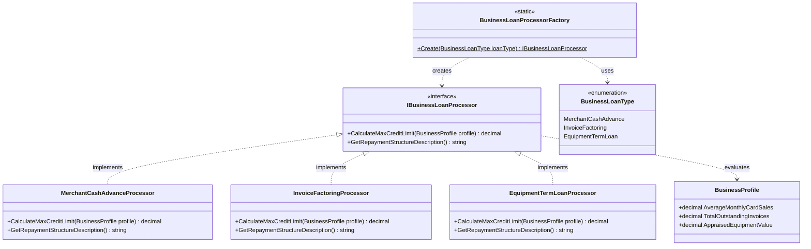

# Factory Method Pattern

## Description

The Factory Method pattern is a creational design pattern that defines an interface for creating an object, but allows the instantiation logic to determine the exact concrete class to produce. It decouples client code from the concrete classes it needs to instantiate, promoting loose coupling and adherence to the Open/Closed Principle.

In this implementation, the **BusinessLoanProcessorFactory** encapsulates the creation of specialized commercial loan processors (`IBusinessLoanProcessor`) based on the requested **BusinessLoanType**:

- **MerchantCashAdvanceProcessor**: Evaluates credit limits against average monthly card sales (`AverageMonthlyCardSales * 1.5`) and uses daily payment gateway remittance splits.
- **InvoiceFactoringProcessor**: Advances funds against eligible unpaid B2B accounts receivable (`TotalOutstandingInvoices * 0.80`) with direct collection from invoice settlements.
- **EquipmentTermLoanProcessor**: Calculates limits against appraised asset liquidation value (`AppraisedEquipmentValue * 0.90`) using fixed monthly principal and interest amortization.

Callers in loan origination or underwriting pipelines interact exclusively through the `IBusinessLoanProcessor` abstraction without knowing the concrete processor classes or their mathematical risk formulas.

---

## Real-World Analogy: Commercial Lending Credit Assessment Desk

Imagine a commercial bank offering specialized financing to different types of businesses:

- **The Product Interface (`IBusinessLoanProcessor`):** The standard underwriting assessment required for any commercial borrower: calculating their maximum borrowing capacity and defining their repayment structure.
- **The Specialized Lending Desks (Concrete Processors):**
  - A *Retail Merchant Desk* assesses liquidity based on daily credit card swipe volumes.
  - A *Trade Finance Desk* assesses liquidity based on outstanding corporate accounts receivable.
  - An *Asset Finance Desk* assesses collateral based on equipment appraisals and depreciation schedules.
- **The Intake Router (`BusinessLoanProcessorFactory`):** When an application arrives, the intake router inspects the requested loan facility type (`BusinessLoanType`) and routes it to the correct specialized desk without the borrower needing to know the internal credit policies of the bank.

```
                  [ Loan Origination Client ]
                               │
                               ▼  Create(BusinessLoanType)
               [ BusinessLoanProcessorFactory ]
                               │
         ┌─────────────────────┼─────────────────────┐
         ▼                     ▼                     ▼
[ MerchantCashAdvance ] [ InvoiceFactoring ]  [ EquipmentTermLoan ]
 (Underwrites Card Vol)  (Advances Invoices)   (Appraises Assets)
         │                     │                     │
         └─────────────────────┼─────────────────────┘
                               ▼
                   [ IBusinessLoanProcessor ]
                    (Calculates credit limit &
                     repayment structure)
```

Clients calling `BusinessLoanProcessorFactory.Create(...)` receive a polymorphic `IBusinessLoanProcessor` ready to evaluate any `BusinessProfile`.

---

## UML Diagram



---

## Role Mapping

| Class / Interface | Factory Method Role | Description |
|---|---|---|
| `IBusinessLoanProcessor` | **Product Interface** | Defines the operations that all concrete loan processors must implement (`CalculateMaxCreditLimit`, `GetRepaymentStructureDescription`). |
| `MerchantCashAdvanceProcessor` | **Concrete Product** | Implements credit calculation and repayment logic for card-sales-backed advances. |
| `InvoiceFactoringProcessor` | **Concrete Product** | Implements credit calculation and repayment logic for accounts receivable factoring. |
| `EquipmentTermLoanProcessor` | **Concrete Product** | Implements credit calculation and repayment logic for equipment collateralized term loans. |
| `BusinessLoanProcessorFactory` | **Creator / Factory** | Declares the factory method `Create(...)` that returns an instance of `IBusinessLoanProcessor`. |
| `BusinessLoanType` | **Discriminator / Type Parameter** | Enum identifying which concrete processor type to instantiate. |
| `BusinessProfile` | **Context Parameter** | Holds financial metrics (card sales, invoices, equipment value) evaluated by processors. |
| `BusinessLoanProcessorFactoryTests` | **Client** | Consumes the factory to obtain processors and verify credit assessments. |

---

## Key Advantages

1. **Eliminates Direct Instantiation Coupling**
   Clients do not depend on concrete processor classes (`new MerchantCashAdvanceProcessor()`). Callers work entirely through the `IBusinessLoanProcessor` interface.

2. **Single Responsibility Principle (SRP)**
   Each concrete processor is responsible for exactly one lending product's credit policies, advance formulas, and repayment rules.

3. **Open/Closed Principle (OCP)**
   Adding a new loan product type (e.g. `CommercialMortgageProcessor`) requires adding the new processor and an enum branch without modifying or risking any existing processor code.

4. **Centralized Input Validation and Error Handling**
   Unsupported or invalid loan types are rejected at the factory boundary (throwing `NotSupportedException`), preventing partially initialized or invalid objects from entering the pipeline.

---

## Scenarios: When to Use the Factory Method Pattern

### 1. Dynamic Commercial Lending & Credit Products
When a lending platform supports multiple credit structures—unsecured revenue advances, invoice factoring, equipment leasing, or real-estate mortgages—a factory selects the appropriate credit underwriting algorithm based on borrower application parameters.

### 2. Multi-Provider Payment Processing & Routing
When a merchant application routes transactions to different payment gateways (Stripe, Adyen, Worldpay) depending on currency, geographical region, or card brand, a factory creates the appropriate gateway adapter.

### 3. Financial Document & Statement Generation
When generating tax reports, regulatory filings, or loan schedules across different jurisdictional formats (US GAAP, IFRS, ATO), a factory instantiates the format-specific report generator based on the legal entity's jurisdiction.

### 4. Risk & Compliance Verification Workflows
Selecting between standard identity verification, enhanced due diligence (EDD), or corporate beneficial ownership (KYB) verification pipelines depending on the entity type.

---

## Factory Method vs. Other Creational Patterns

| Pattern | Primary Intent | Key Difference from Factory Method |
|---|---|---|
| **Factory Method** | Creates a **single product** chosen polymorphically | Focuses on one product hierarchy; delegates selection to a factory method |
| **Abstract Factory** | Creates **families of related products** (e.g., Bank Guarantee + Business Overdraft) | Coordinates creation of multiple related product interfaces without specifying concrete classes |
| **Builder** | Constructs a **complex product step-by-step** | Focuses on assembling a single complex object with many parameters (e.g., `LoanApplication`) |
| **Prototype** | Creates new objects by **cloning an existing instance** | Replaces instantiation with cloning when object creation is expensive |

---

## Extending the Factory: Adding a New Loan Type

To add a new lending product (e.g., `CommercialMortgage`):

### 1. Update the `BusinessLoanType` enum

```csharp
public enum BusinessLoanType
{
    MerchantCashAdvance,
    InvoiceFactoring,
    EquipmentTermLoan,
    CommercialMortgage // New type
}
```

### 2. Implement `IBusinessLoanProcessor`

```csharp
namespace FactoryMethod;

public class CommercialMortgageProcessor : IBusinessLoanProcessor
{
    public decimal CalculateMaxCreditLimit(BusinessProfile profile)
    {
        // 70% Loan-to-Value on commercial property valuation
        return profile.AppraisedPropertyValuation * 0.70M;
    }

    public string GetRepaymentStructureDescription() =>
        "Monthly amortization over a 15-to-30 year term secured by commercial real estate.";
}
```

### 3. Register in `BusinessLoanProcessorFactory`

```csharp
public static IBusinessLoanProcessor Create(BusinessLoanType loanType)
{
    return loanType switch
    {
        BusinessLoanType.MerchantCashAdvance => new MerchantCashAdvanceProcessor(),
        BusinessLoanType.InvoiceFactoring => new InvoiceFactoringProcessor(),
        BusinessLoanType.EquipmentTermLoan => new EquipmentTermLoanProcessor(),
        BusinessLoanType.CommercialMortgage => new CommercialMortgageProcessor(), // New branch
        _ => throw new NotSupportedException($"Unsupported business loan type: {loanType}")
    };
}
```

### What you DON'T need to modify

| File | Required? |
|---|---|
| `IBusinessLoanProcessor.cs` | ❌ No |
| `MerchantCashAdvanceProcessor.cs` | ❌ No |
| `InvoiceFactoringProcessor.cs` | ❌ No |
| `EquipmentTermLoanProcessor.cs` | ❌ No |
| Existing client code consuming `IBusinessLoanProcessor` | ❌ No |

---

## Unit Testing with Shouldly

The test suite validates factory instantiation and mathematical limits across all product variants:

```csharp
[Theory]
[InlineData(BusinessLoanType.MerchantCashAdvance, typeof(MerchantCashAdvanceProcessor))]
[InlineData(BusinessLoanType.InvoiceFactoring, typeof(InvoiceFactoringProcessor))]
[InlineData(BusinessLoanType.EquipmentTermLoan, typeof(EquipmentTermLoanProcessor))]
public void Create_ReturnsExpectedProcessor_ForGivenLoanType(BusinessLoanType loanType, Type expectedProcessorType)
{
    // Act
    var processor = BusinessLoanProcessorFactory.Create(loanType);

    // Assert
    processor.ShouldNotBeNull();
    processor.ShouldBeOfType(expectedProcessorType);
}

[Fact]
public void Create_ThrowsNotSupportedException_ForInvalidLoanType()
{
    // Act & Assert
    Should.Throw<NotSupportedException>(() => 
        BusinessLoanProcessorFactory.Create((BusinessLoanType)999));
}

[Fact]
public void MerchantCashAdvanceProcessor_CalculatesCorrectLimitAndDescription()
{
    // Arrange
    var processor = new MerchantCashAdvanceProcessor();
    var profile = new BusinessProfile { AverageMonthlyCardSales = 10000M };

    // Act
    var limit = processor.CalculateMaxCreditLimit(profile);
    var description = processor.GetRepaymentStructureDescription();

    // Assert
    limit.ShouldBe(15000M); // 10,000 * 1.5
    description.ShouldNotBeNullOrWhiteSpace();
}
```

