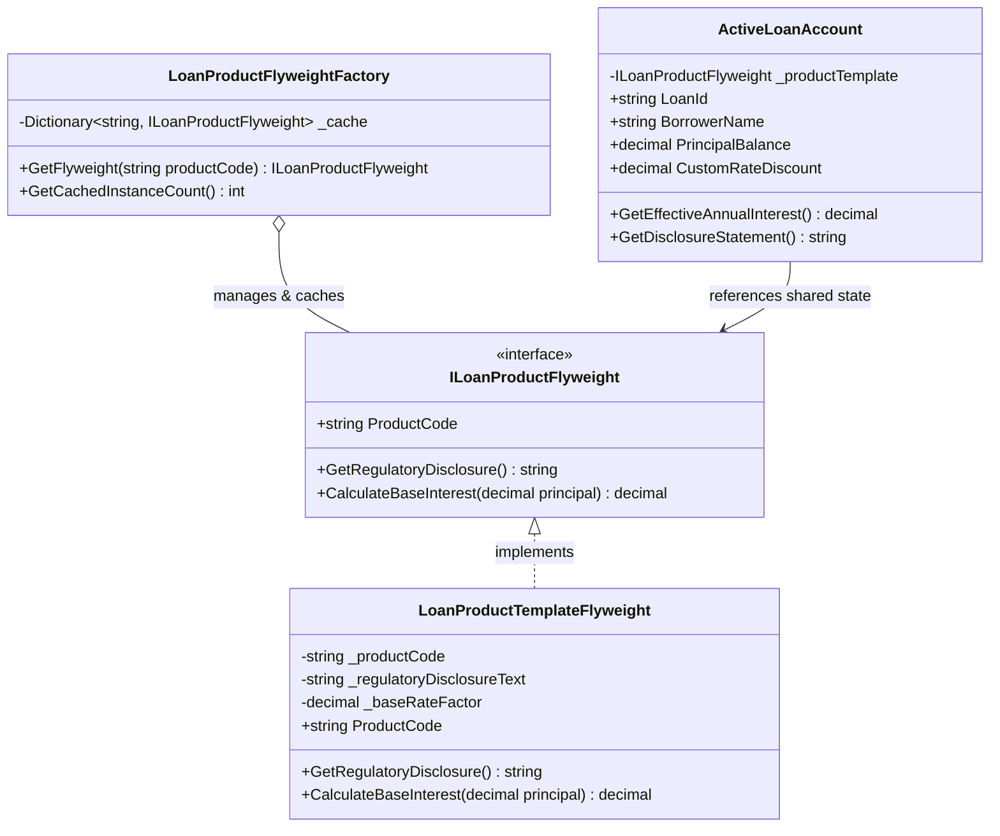

# Flyweight Pattern

## Description

The Flyweight pattern is a structural design pattern that lets you support vast numbers of fine-grained objects efficiently by sharing common state across multiple objects, rather than keeping all data duplicated in every single instance. It separates an object's state into two categories: **intrinsic state** (shared, immutable data that is independent of the object's context) and **extrinsic state** (unique context-dependent data passed in or computed on the fly).

In this implementation, the **LoanProductTemplateFlyweight** stores heavy, immutable financial metadata—such as base regulatory disclosure text, standard amortization rules, compliance checklists, and base product codes—shared across thousands of individual active loan accounts. Meanwhile, the individual loan records maintain only their unique **extrinsic state** (such as the borrower ID, unique loan identifier, specific principal balance, and customized interest rate discount).

Callers and ledger operations invoke operations on active loans by passing the extrinsic context to the shared flyweight instance, drastically minimizing memory footprint and object allocation overhead in high-scale lending systems.

---

## Real-World Analogy: Standardized Lending Product Blueprints and Active Loan Accounts

Imagine a digital lending platform managing 500,000 active small-business loans:

- **The Shared Product Template (`ILoanProductFlyweight`):** The master legal disclosure, regulatory compliance rules (e.g., Truth in Lending Act disclosures), and baseline calculation engine for a standard "SME Working Capital Line." Instead of duplicating these 50KB JSON compliance documents and validation rules inside all 500,000 loan objects, the bank keeps **one** shared template instance in memory.
- **The Factory / Cache (`LoanProductFlyweightFactory`):** A flyweight pool manager that ensures identical product templates are created once and reused whenever a new loan is originated under that product code.
- **The Active Loan Context (`ActiveLoanAccount`):** The lightweight unique record for an individual borrower containing only what makes them unique: their specific `LoanId`, `BorrowerName`, `CurrentPrincipal`, and `AssignedRate`. When a calculation is needed, the active loan references the shared flyweight and passes its unique state as parameters.

```
                  [ Loan Origination Service ]
                               │
                               ▼ GetFlyweight(ProductCode)
               [ LoanProductFlyweightFactory ]
                               │
            ┌──────────────────┴──────────────────┐
            ▼                                     ▼
   [ StandardSmeFlyweight ]              [ EquipmentFlyweight ]
   (Shared Intrinsic State:              (Shared Intrinsic State:
    Compliance Rules, Terms)              Asset Rules, Disclosures)
            ▲                                     ▲
            └──────────────────┬──────────────────┘
                               │ Referenced by thousands of
                               │
         ┌─────────────────────┼─────────────────────┐
         ▼                     ▼                     ▼
[ ActiveLoanAccount A ] [ ActiveLoanAccount B ] [ ActiveLoanAccount C ]
 (Extrinsic State:       (Extrinsic State:       (Extrinsic State:
  ID: 101, Bal: $50k)     ID: 102, Bal: $120k)    ID: 103, Bal: $15k)
```

Clients interact with active loans that delegate compliance and baseline checks to the shared flyweight by supplying their runtime extrinsic context.

---

## UML Diagram



---

## Role Mapping

| Class / Interface | Flyweight Role | Description |
|---|---|---|
| `ILoanProductFlyweight` | **Flyweight Interface** | Defines the interface through which flyweights can receive and act on extrinsic state. |
| `LoanProductTemplateFlyweight` | **Concrete Flyweight** | Implements the interface and stores **intrinsic state** (product code, regulatory text, base rate factor). Must be completely immutable. |
| `LoanProductFlyweightFactory` | **Flyweight Factory** | Manages the flyweight pool/cache. Ensures flyweights are shared properly; creates a new instance only if it does not already exist. |
| `ActiveLoanAccount` | **Context (Client)** | Contains **extrinsic state** (unique loan ID, principal balance, borrower details) and holds a reference to the shared flyweight. |
| `FlyweightTests` | **Client / Test Suite** | Validates that cache sharing works correctly and memory overhead is minimized across multiple loan instances. |

---

## Key Advantages

1. **Massive Memory Footprint Reduction**
   Instead of storing heavy compliance text, master templates, and baseline logic across hundreds of thousands of independent domain objects, identical data is stored exactly once in memory.

2. **Strict Immutable State Separation**
   By cleanly separating intrinsic (shared/read-only) state from extrinsic (contextual/runtime) state, you prevent accidental data corruption across concurrent threads evaluating different loans.

3. **Centralized Product Governance**
   Updating a regulatory compliance disclosure or baseline product formula requires modifying only the shared flyweight instance, instantly propagating the update across all active loans referencing it.

4. **Optimized Object Pooling and Caching**
   The factory pattern encapsulates instance caching, ensuring that repetitive database lookups or object allocations for standard product definitions are eliminated.

---

## Scenarios: When to Use the Flyweight Pattern

### 1. High-Volume Loan Portfolios & Core Banking Ledgers
When a digital bank or micro-lending platform holds millions of active consumer loans that share identical underlying product definitions, fee schedules, and regulatory compliance texts.

### 2. Credit Scoring & Risk Matrix Caching
When scoring engines evaluate thousands of loan applications daily against large, complex static credit matrices or scoring lookup tables that remain constant throughout the evaluation batch.

### 3. Financial Document & Disclosure Rendering Engines
When generating bulk periodic statements or disclosure notices for thousands of accounts where the boilerplate legal text is identical across categories of financial products.

### 4. Chart of Accounts & General Ledger Hierarchies
When mapping massive transactional ledgers where thousands of individual ledger entries point to shared, standardized general ledger account definitions and classification codes.

---

## Flyweight vs. Other Structural Patterns

| Pattern | Primary Intent | Key Difference from Flyweight |
|---|---|---|
| **Flyweight** | Shares **state** to support large numbers of fine-grained objects efficiently | Focuses on memory conservation through state sharing (Intrinsic vs. Extrinsic) |
| **Proxy** | Provides a **surrogate or placeholder** for another object to control access | Focuses on access control, lazy loading, or remote communication, not memory optimization |
| **Decorator** | Adds **responsibilities** to objects dynamically without subclassing | Focuses on adding behavior via wrapping, whereas Flyweight focuses on minimizing object count and memory |
| **Facade** | Provides a **simplified interface** to a complex subsystem | Focuses on API simplification rather than object instance management |
