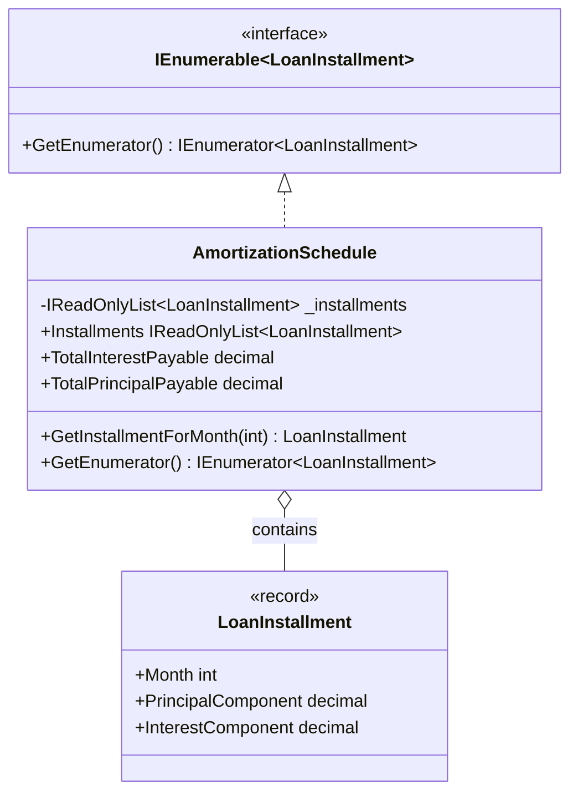

# Iterator Pattern

## Description

The Iterator pattern provides a standard way to traverse a collection without
exposing how the collection is stored. In a lending system, an
`AmortizationSchedule` represents a loan's installments while allowing callers
to use `foreach`, LINQ, and the standard `IEnumerable<LoanInstallment>`
interfaces.

The schedule snapshots the installments supplied at construction and exposes
them through a read-only collection. Each `LoanInstallment` is immutable, so
callers cannot change a schedule by mutating either its original input or its
read-only view.

## Diagram



## Roles

| Class / Interface | Iterator Role | Responsibility |
| --- | --- | --- |
| `IEnumerable<LoanInstallment>` | Aggregate interface | Provides standard generic traversal and LINQ support. |
| `AmortizationSchedule` | Concrete aggregate and iterator provider | Owns an immutable snapshot, computes schedule totals, looks up installments by month, and provides generic and non-generic enumeration. |
| `LoanInstallment` | Element | Represents the principal and interest components due in one month. |
| Calling code | Client | Enumerates or queries the schedule without depending on its internal storage. |

## Example

```csharp
var schedule = new AmortizationSchedule(
[
    new LoanInstallment(1, 900m, 100m),
    new LoanInstallment(2, 910m, 90m)
]);

foreach (var installment in schedule)
{
    Console.WriteLine(
        $"Month {installment.Month}: {installment.PrincipalComponent + installment.InterestComponent:C}");
}

decimal interest = schedule.TotalInterestPayable; // 190m
LoanInstallment? secondMonth = schedule.GetInstallmentForMonth(2);
```

## Benefits

- Consumers can use `foreach` and LINQ without accessing internal storage.
- Read-only snapshots prevent callers from changing the schedule after creation.
- Schedule-level totals and month lookup keep common domain queries close to the data.
- Generic and non-generic enumeration support standard .NET collection APIs.

## When to Use

Use the Iterator pattern when callers need to traverse a collection through a
stable interface without coupling themselves to its storage or traversal
details. In lending, this is useful for processing repayment schedules,
generating statements, and calculating totals.
