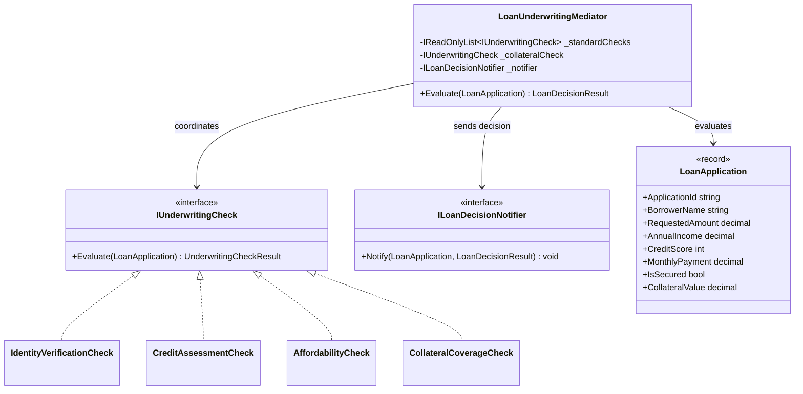

# Mediator Pattern

## Description

The Mediator pattern centralizes communication between collaborating objects.
Instead of underwriting checks calling one another or the borrower notification
service directly, `LoanUnderwritingMediator` coordinates them and determines
the final application outcome.

This example evaluates identity, credit, and affordability for every loan
application. Secured applications also pass through a collateral coverage
check. The mediator combines the results into an approval, decline, or manual
review decision, then notifies the decision service.

## Real-World Analogy: Loan Underwriting

A loan application passes through several specialized underwriting
participants:

- **Identity verification** checks that the application identifies a borrower.
- **Credit assessment** approves strong scores, declines scores below the
  minimum, and routes borderline scores to manual review.
- **Affordability assessment** checks proposed repayments against annual income.
- **Collateral assessment** checks secured applications against the minimum
  collateral coverage ratio.
- **Decision notification** communicates the final result.

The checks remain focused on their own criteria. The mediator controls which
checks run and resolves their results without making the checks depend on one
another.

## Diagram



## Roles

| Role / Component | Generic Responsibility | Lending Implementation |
| --- | --- | --- |
| Mediator | Coordinates interactions among colleagues and centralizes workflow decisions. | `LoanUnderwritingMediator` runs the applicable checks, combines their outcomes, and notifies the decision service. |
| Colleagues | Perform specialized work without directly coordinating with each other. | `IdentityVerificationCheck`, `CreditAssessmentCheck`, `AffordabilityCheck`, and `CollateralCoverageCheck`. |
| Notification colleague | Responds to the mediator's completed workflow. | `ILoanDecisionNotifier` delivers the final approval, decline, or manual-review result. |
| Request | Carries the information used by the workflow. | `LoanApplication` contains borrower, loan, repayment, and optional collateral details. |

## Example

```csharp
var mediator = new LoanUnderwritingMediator(
    [
        new IdentityVerificationCheck(),
        new CreditAssessmentCheck(),
        new AffordabilityCheck()
    ],
    new CollateralCoverageCheck(),
    decisionNotifier);

var result = mediator.Evaluate(application);
```

For an unsecured application, the mediator skips collateral assessment. For a
secured application, it runs that check as well. A decline takes precedence
over manual review; if there are no declines but at least one check requests
manual review, the application is routed for review. Otherwise, it is approved.

## Benefits

- Underwriting checks remain independent and focused on one criterion.
- The workflow and conditional secured-loan behavior live in one coordinator.
- New checks can be added without wiring direct dependencies between existing
  checks.
- Decision precedence and notification happen consistently for every
  application.

## When to Use

Use the Mediator pattern when multiple services or domain participants must
coordinate a workflow, especially when routing rules depend on the request or
on results from several colleagues. Keep domain rules inside the relevant
checks and let the mediator coordinate their execution and outcomes.

## When Not to Use

Avoid the Mediator pattern when each stage requires the previous stage's output
to decide what to do next. That is a dependent, ordered workflow; a Pipeline is
usually a clearer fit when stages pass data along or transform a request, while
Chain of Responsibility fits when a handler can process the request or pass it
to the next handler. A mediator can run colleagues in a defined order, but
ordering alone does not make the pattern a good fit if those colleagues are
tightly dependent on one another.
