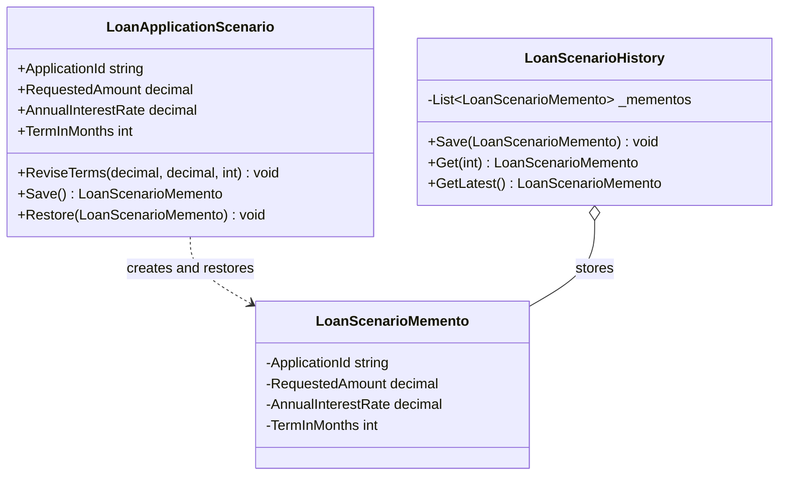

# Memento Pattern

## Description

The Memento pattern captures and restores an object's previous state without
exposing the details of that state to the object managing the snapshots. In this
lending example, an underwriter can save a loan application's current terms,
try a different amount, rate, or term, and restore a saved scenario if needed.

`LoanApplicationScenario` is the originator: it creates snapshots and restores
its own state from them. `LoanScenarioMemento` stores an immutable snapshot with
state hidden from callers. `LoanScenarioHistory` is the caretaker: it keeps
snapshots and lets the user select one without interpreting its contents.

Snapshots support scenario exploration and undo. They are not a regulatory
audit log; restoring a scenario does not record who changed what or when.
Compliance and audit history should be captured separately as immutable,
attributable events.

## Real-World Analogy: Comparing Loan Terms

An underwriter is considering a loan for \$100,000 at 6.5% over 60 months.
They save those terms, model a \$80,000 offer at a different rate and term, then
try another scenario. The saved snapshot lets them return to the earlier offer
without manually re-entering its values.

## Diagram



## Roles

| Class / Interface | Memento Role | Responsibility |
| --- | --- | --- |
| `LoanApplicationScenario` | Originator | Owns the editable loan terms, creates snapshots, and restores its state. |
| `LoanScenarioMemento` | Memento | Holds an immutable snapshot whose state is only accessible within the domain assembly. |
| `LoanScenarioHistory` | Caretaker | Stores snapshots and returns a selected or latest snapshot without inspecting its state. |
| Underwriter | Client | Saves scenarios before experimenting, then asks the originator to restore a chosen snapshot. |

## Example

```csharp
var scenario = new LoanApplicationScenario(
    "LN-1001",
    requestedAmount: 100_000m,
    annualInterestRate: 0.065m,
    termInMonths: 60);
var history = new LoanScenarioHistory();

history.Save(scenario.Save());

scenario.ReviseTerms(
    requestedAmount: 80_000m,
    annualInterestRate: 0.0725m,
    termInMonths: 48);

scenario.Restore(history.GetLatest());
```

## Benefits

- Users can compare loan-term scenarios and restore a previous version.
- Snapshot state stays encapsulated from the history caretaker.
- Immutable snapshots are not changed when the active scenario is revised.
- Scenario undo remains separate from compliance and audit event recording.

## When to Use

Use the Memento pattern when an object needs to support undo, rollback, or
scenario comparison while keeping its internal state encapsulated. In lending,
it can support an underwriter's what-if analysis of proposed terms.

## When Not to Use

Do not use Memento as a substitute for a durable audit trail or event history.
Snapshots are for restoring application state; regulated audit records should
capture attributable changes and remain available even when a scenario is
restored.
