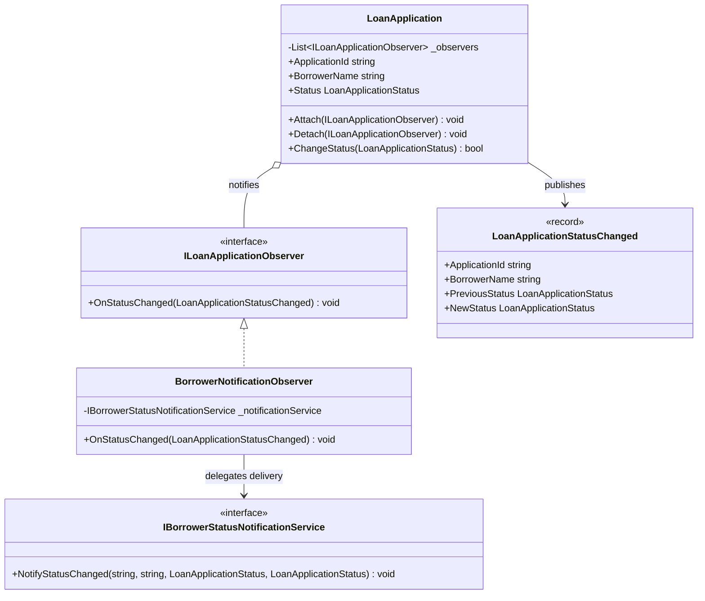

# Observer Pattern

## Description

The Observer pattern defines a one-to-many relationship between a subject and
its observers. When the subject changes state, it notifies its registered
observers without needing to know their concrete types or responsibilities.

In this lending example, a `LoanApplication` is the subject. When its status
changes, it publishes an immutable `LoanApplicationStatusChanged` event to its
observers. A `BorrowerNotificationObserver` forwards the update to a borrower
notification service. Other observers, such as an underwriting dashboard or
servicing work queue, can subscribe independently.

## Real-World Analogy: Loan Application Status Updates

When an application moves from draft to submitted, into underwriting, or to an
approval decision, several parts of a lending system may need to react:

- The borrower notification service sends a status update.
- An underwriting dashboard refreshes its queue.
- A servicing workflow can prepare next steps after approval or funding.

The application publishes the status transition once; each subscribed
observer handles its own response.

## Diagram



## Roles

| Class / Interface | Observer Role | Responsibility |
| --- | --- | --- |
| `LoanApplication` | Subject | Owns the current status and notifies attached observers when it changes. |
| `ILoanApplicationObserver` | Observer | Defines the callback for a loan status transition. |
| `BorrowerNotificationObserver` | Concrete observer | Forwards status transitions to the borrower notification service. |
| `IBorrowerStatusNotificationService` | Notification boundary | Abstracts the delivery mechanism from the observer and subject. |
| `LoanApplicationStatusChanged` | Event state | Carries immutable application and previous/new status details. |

## Example

```csharp
var application = new LoanApplication("LN-1001", "Jordan Lee");
var borrowerObserver = new BorrowerNotificationObserver(notificationService);

application.Attach(borrowerObserver);
application.ChangeStatus(LoanApplicationStatus.Submitted);
application.ChangeStatus(LoanApplicationStatus.UnderReview);
```

Observers are notified only when the status actually changes. Attaching the
same observer more than once does not create duplicate notifications, and a
detached observer no longer receives updates.

## Benefits

- The application does not depend on specific notification, dashboard, or
  servicing implementations.
- New subscribers can react to status changes without changing the subject.
- Each observer owns its own response to the published transition.
- The immutable event records both the previous and new status for consumers.

## When to Use

Use the Observer pattern when multiple independent components need to react to
changes in a subject's state. In lending, it is useful for application status
updates that may be relevant to borrowers, underwriting operations, and
downstream servicing.

## When Not to Use

Avoid Observer when subscribers require a strict, dependent execution order or
when the subject must coordinate a workflow and combine subscriber results.
Use a pipeline or mediator when those responsibilities are required. For
reliable cross-process delivery, use a durable messaging or eventing mechanism
instead of relying solely on in-memory observers.
