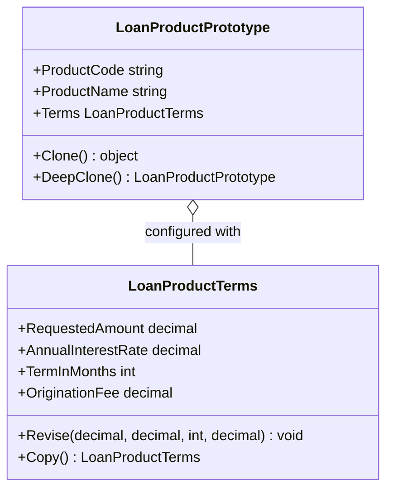

# Prototype Pattern

## Description

The Prototype pattern creates new objects by copying a configured instance,
avoiding repeated construction of objects with the same baseline setup.

In this lending example, `LoanProductPrototype` represents a preconfigured
product offer. A lender can clone the SME working-capital product and adjust
the cloned loan terms for an individual borrower. A shallow clone shares the
nested terms object with its source; a deep clone copies the terms so changes
to the borrower-specific offer do not affect the prototype.

## Real-World Analogy: Creating Borrower-Specific Loan Offers

A lender maintains a standard SME working-capital product with baseline
principal, interest rate, term, and origination fee. When preparing an offer,
the lender clones that prototype and customizes the terms for the borrower.
This keeps the standard product configuration available for the next offer.

## Diagram



## Roles

| Class / Interface | Prototype Role | Responsibility |
| --- | --- | --- |
| `LoanProductPrototype` | Prototype | Stores the configured product and creates shallow or deep copies. |
| `LoanProductTerms` | Nested state | Holds the adjustable monetary and duration terms and can create an independent copy. |
| Lending offer workflow | Client | Clones a product template and customizes the resulting offer. |

## Example

```csharp
var productTemplate = new LoanProductPrototype(
    "SME-WORKING-CAPITAL",
    "SME Working Capital Loan",
    new LoanProductTerms(100_000m, 0.065m, 60, 1_000m));

var borrowerOffer = productTemplate.DeepClone();
borrowerOffer.Terms.Revise(75_000m, 0.079m, 48, 750m);
```

Use `DeepClone()` when a borrower-specific offer must have terms independent of
the reusable product prototype. `Clone()` is intentionally shallow: both
objects share the same `LoanProductTerms`, so editing those terms affects both.

## Benefits

- Creates configured offers without rebuilding all baseline product details.
- Deep cloning isolates borrower-specific changes from the reusable template.
- Shallow and deep copy behavior makes shared versus independent nested state explicit.
- New product configurations can be introduced as new prototypes.

## When to Use

Use the Prototype pattern when many objects share a configured baseline and
copying that baseline is simpler than reconstructing each object. In lending,
it can be useful for creating borrower-specific offers from standard loan
product templates.

## When Not to Use

Avoid cloning when objects contain complex resources or identity-sensitive state
that cannot be safely copied. Be explicit about shallow versus deep copying:
shared mutable terms can cause one offer to alter another or the original
product template.
