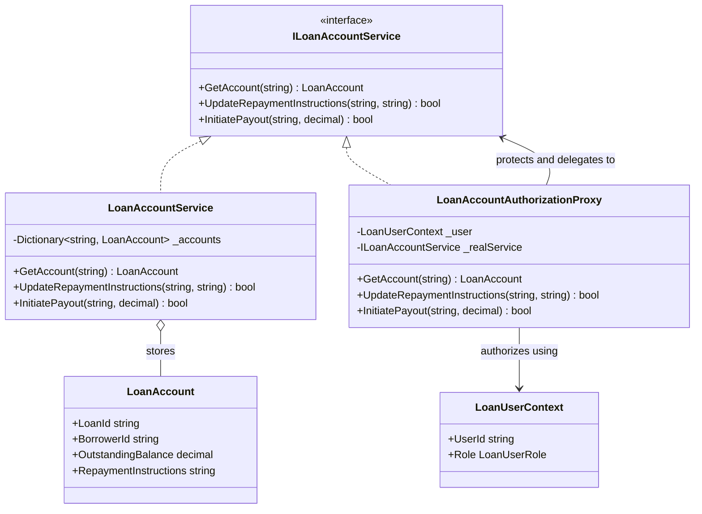

# Proxy Pattern

## Description

The Proxy pattern provides a stand-in for an object while preserving the same
interface. A proxy can control access to the real object, add validation or
logging, or defer expensive work.

This example uses a protection proxy for lending operations. Both
`LoanAccountAuthorizationProxy` and `LoanAccountService` implement
`ILoanAccountService`. The proxy checks the caller's role and, for borrowers,
their relationship to the loan before forwarding sensitive operations.

## Real-World Analogy: Loan Account Access

Loan-account information and operations have different access requirements:

- A borrower can view and update repayment instructions for their own loan.
- A loan officer can view loans but cannot alter repayment instructions or
  initiate payouts.
- A servicing administrator can view and manage loan accounts and initiate
  payouts.

The caller uses the same service contract regardless of whether the real
service or the authorization proxy is provided.

## Diagram



## Roles

| Class / Interface | Proxy Role | Responsibility |
| --- | --- | --- |
| `ILoanAccountService` | Subject | Defines account operations available to clients. |
| `LoanAccountService` | Real subject | Performs loan-account reads and mutations. |
| `LoanAccountAuthorizationProxy` | Protection proxy | Enforces role- and borrower-based access before forwarding operations. |
| `LoanUserContext` | Authorization context | Identifies the caller and their lending role. |
| Calling code | Client | Uses the same service interface without directly deciding access policy. |

## Example

```csharp
ILoanAccountService accountService = new LoanAccountAuthorizationProxy(
    currentUser,
    loanAccountService);

var account = accountService.GetAccount("LN-1001");
var updated = accountService.UpdateRepaymentInstructions(
    "LN-1001",
    "New repayment account");
```

The proxy returns no account for an unauthorized read and returns `false` for
unauthorized mutations. It delegates only after authorization succeeds.

## Benefits

- Centralizes access checks around an existing service contract.
- Keeps callers independent of whether the real service or proxy is used.
- Applies role and borrower-account checks consistently to sensitive operations.
- Lets the real service focus on account operations rather than caller policy.

## When to Use

Use a protection proxy when access to an object should be checked before its
operations are exposed. In lending, it can demonstrate borrower, loan-officer,
and servicing-administrator permissions for account access.

## When Not to Use

Do not treat an in-process proxy as the only security boundary. Enforce
authorization at trusted service or API boundaries too, and derive user
identity and roles from authenticated claims rather than accepting
caller-supplied values. Keep proxy checks aligned with the authoritative
authorization policy to avoid inconsistent access decisions.
