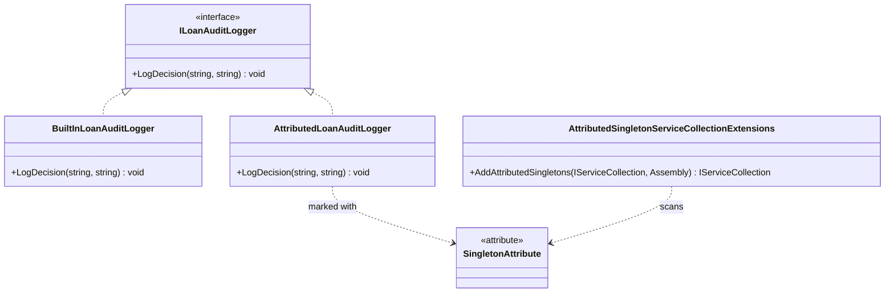

# Singleton Pattern with Dependency Injection

## Description

The Singleton pattern ensures a service has one shared instance. In modern
applications, dependency injection (DI) containers usually manage this
lifecycle more cleanly than a service exposing a global static `Instance`.

This example uses Microsoft's DI container to register a loan audit logger
with singleton, scoped, or transient lifetime. It also demonstrates an
opt-in `[Singleton]` attribute convention. The attribute has no behavior on
its own; `AddAttributedSingletons` scans an assembly and registers attributed
implementations and their interfaces as shared singleton services.

## Lending Example: Shared Audit Logging

A lending application may inject the same audit logger into loan application,
underwriting, and servicing services. A singleton registration shares the
logger instance for the lifetime of the service provider. The logger is
stateless in this example; real shared services should be designed for
concurrent use and should not store per-request or per-borrower mutable state.

## Diagram



## Roles

| Class / Interface | Singleton Role | Responsibility |
| --- | --- | --- |
| `ILoanAuditLogger` | Service contract | Describes the audit logging capability consumed by lending services. |
| `BuiltInLoanAuditLogger` | Explicitly registered service | Writes audit messages; Microsoft DI controls its lifetime through the registration call. |
| `AttributedLoanAuditLogger` | Attributed service | Writes audit messages; the custom scanner discovers this class because it carries `[Singleton]`. |
| DI container | Lifecycle manager | Creates and reuses the service according to singleton, scoped, or transient registration. |
| `SingletonAttribute` | Registration marker | Marks a class for the optional assembly-scanning registration convention. |
| `AddAttributedSingletons` | Registration helper | Registers marked concrete types and their interfaces as singleton services. |

## Registering Explicitly (Recommended)

```csharp
var services = new ServiceCollection();
services.AddSingleton<ILoanAuditLogger, BuiltInLoanAuditLogger>();

using var provider = services.BuildServiceProvider();
var auditLogger = provider.GetRequiredService<ILoanAuditLogger>();
```

Explicit registration is visible, easy to navigate, and uses the DI container's
built-in lifetime support. Choose scoped or transient lifetimes when a service
should not be shared for the entire provider lifetime.

## Attribute-Based Registration (Opt-In Convention)

```csharp
var services = new ServiceCollection();
services.AddAttributedSingletons(typeof(AttributedLoanAuditLogger).Assembly);

using var provider = services.BuildServiceProvider();
var auditLogger = provider.GetRequiredService<ILoanAuditLogger>();
```

`[Singleton]` is a project-defined attribute, not a built-in .NET DI feature.
It only affects registrations when the assembly is passed to
`AddAttributedSingletons`. The helper registers the class and its implemented
interfaces to resolve to the same singleton instance.

## Benefits

- The DI container owns object creation and lifetime rather than application
  code relying on a global static instance.
- Explicit registration clearly communicates service lifetime.
- The optional attribute convention can reduce repetitive registration in
  projects that deliberately use assembly scanning.
- Tests can build isolated service providers and verify the chosen lifetime.

## When to Use

Use singleton lifetime for services that are safe to share across concurrent
operations and whose state is application-wide, such as immutable
configuration-backed services or thread-safe infrastructure components.
Prefer explicit DI registration by default.

## When Not to Use

Do not register request-specific or borrower-specific mutable state as a
singleton. Avoid using singleton lifetime merely to avoid constructing
objects, and avoid custom `[Singleton]` scanning if it hides registrations or
makes service wiring difficult to discover. The attribute is a convention, not
a security or lifecycle guarantee unless the registration helper is used.
