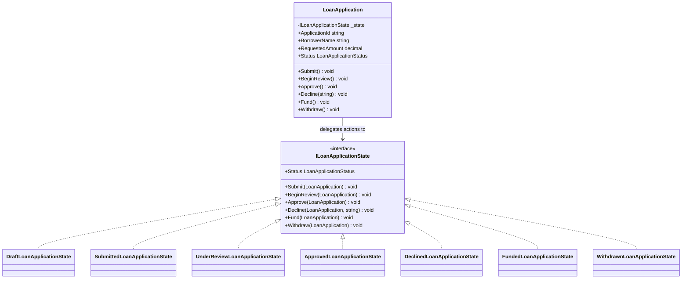

# State Pattern

## Description

The State pattern lets an object change its behavior when its internal state
changes. Instead of placing every status-dependent rule in one large
conditional, the object delegates actions to a state object representing its
current state.

In this lending example, `LoanApplication` delegates lifecycle actions to its
current state. A draft can be submitted; a submitted application can enter
review or be withdrawn; an application under review can be approved, declined,
or withdrawn; and only an approved application can be funded. Declined,
funded, and withdrawn applications are terminal in this simplified workflow.

## Real-World Analogy: Loan Application Lifecycle

A loan application progresses through underwriting. Which operations are
available depends on where it is in the lifecycle:

- A draft can be submitted.
- A submitted application can enter review or be withdrawn.
- An application under review can be approved, declined with a reason, or
  withdrawn.
- An approved application can be funded.
- Declined, funded, and withdrawn applications cannot be changed through this
  workflow.

The example focuses on lifecycle behavior; it does not attempt to model every
operational, regulatory, or servicing rule in a production lending system.

## Diagram



## Roles

| Class / Interface | State Role | Responsibility |
| --- | --- | --- |
| `LoanApplication` | Context | Holds application data and delegates lifecycle actions to the current state. |
| `ILoanApplicationState` | State | Defines lifecycle actions whose behavior depends on the current state. |
| `DraftLoanApplicationState` and other concrete states | Concrete state | Implements the actions allowed in that lifecycle state and performs transitions. |
| `LoanApplicationStatus` | Public state view | Exposes the current lifecycle status without exposing internal state objects. |

## Example

```csharp
var application = new LoanApplication("LN-1001", "Jordan Lee", 100_000m);

application.Submit();
application.BeginReview();
application.Approve();
application.Fund();
```

Calling an action that is not available in the current state throws
`InvalidOperationException`. Declining requires a non-empty reason, which is
stored on the application when the under-review state accepts the transition.

## Benefits

- Lifecycle rules are organized by state rather than a growing status switch.
- Invalid operations are rejected by the current state.
- Adding a new lifecycle state can be localized to its state implementation
  and relevant transitions.
- Callers use the same application methods throughout the lifecycle.

## When to Use

Use the State pattern when an object's allowed operations and behavior change
significantly as it moves through a lifecycle. Loan origination workflows are
a natural example when each stage has different valid actions.

## When Not to Use

Avoid the State pattern for a small set of statuses that only affect simple
display or reporting. Separate state classes can add unnecessary ceremony when
there is little state-specific behavior or few transition rules.
