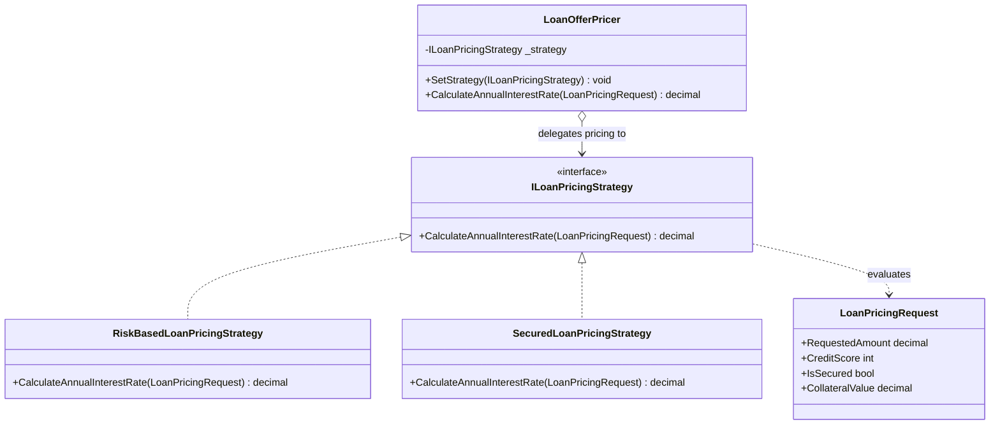

# Strategy Pattern

## Description

The Strategy pattern defines a family of algorithms behind a common interface,
so a client can use or change an algorithm without depending on its concrete
implementation.

In this lending example, `LoanOfferPricer` delegates annual interest-rate
calculation to an `ILoanPricingStrategy`. A risk-based strategy chooses a rate
from the borrower's credit-score tier; a secured-loan strategy validates
collateral coverage and applies secured-loan pricing.

## Real-World Analogy: Loan Offer Pricing

Lenders may apply different pricing policies depending on the product or
underwriting context:

- **Risk-based pricing** assigns a rate by credit-score tier.
- **Secured-loan pricing** requires sufficient collateral coverage and uses
  secured-loan rate tiers.

The offer-pricing workflow can select the appropriate policy without embedding
every pricing formula in one large conditional.

## Diagram



## Roles

| Class / Interface | Strategy Role | Responsibility |
| --- | --- | --- |
| `LoanOfferPricer` | Context | Holds the selected strategy and delegates rate calculation. |
| `ILoanPricingStrategy` | Strategy | Defines the contract for calculating an annual interest rate. |
| `RiskBasedLoanPricingStrategy` | Concrete strategy | Selects a rate from credit-score tiers. |
| `SecuredLoanPricingStrategy` | Concrete strategy | Validates secured status and collateral coverage before selecting a secured rate. |
| `LoanPricingRequest` | Input | Supplies the amount, credit score, and security details required by the strategies. |

## Example

```csharp
var pricer = new LoanOfferPricer(new RiskBasedLoanPricingStrategy());
var request = new LoanPricingRequest(100_000m, creditScore: 700);
decimal annualRate = pricer.CalculateAnnualInterestRate(request); // 9.5%

pricer.SetStrategy(new SecuredLoanPricingStrategy());
```

The example's rates and thresholds are illustrative only; they are not lending
or financial advice.

## Benefits

- Pricing policies are isolated from the offer-pricing context.
- Strategies can be selected or replaced without changing the context.
- Each policy can be tested independently.
- Adding another pricing policy does not require extending one central
  conditional with another algorithm.

## When to Use

Use the Strategy pattern when a workflow needs interchangeable algorithms that
share a stable contract, such as selecting among different lending pricing
policies.

## When Not to Use

Avoid separate strategy classes when there is only one simple algorithm or
when the variations are trivial. A small conditional may be clearer. Ensure
the selected policy is appropriate for the product and validated by the
authoritative underwriting rules; the illustrative rates in this example are
not production pricing guidance.
